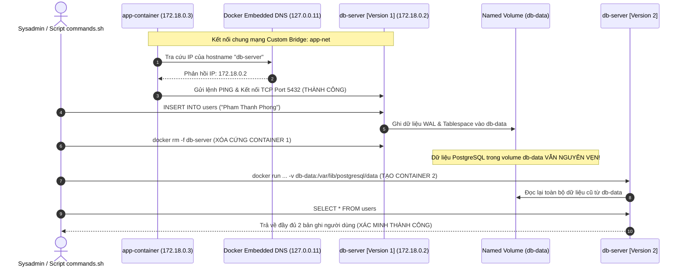

# Báo cáo Bài tập 4: Thiết lập Custom Network & Named Volume bằng Docker CLI

- **Họ và tên:** Phạm Thanh Phong
- **Mã sinh viên:** N24DTCN120
- **Môn học:** IT209
- **Session:** 10
- **Bài tập:** 04 (BT4)
- **Tệp nộp bài:** [README.md](./README.md), [commands.sh](./commands.sh)
- **Đường dẫn trên GitHub:** `homework/session_10/ex4/`

---

## 1. Bối cảnh & Mục tiêu kỹ thuật

### 1.1. Bối cảnh
Trong kiến trúc ứng dụng đa dịch vụ (Multi-container Architecture), hai bài toán lớn nhất cần giải quyết là:
1. **Khám phá dịch vụ (Service Discovery) & Giao tiếp nội bộ:** Các container cần tìm thấy nhau mà không được phụ thuộc vào địa chỉ IP cứng (hard-coded IP), vì IP của container thường thay đổi ngẫu nhiên mỗi khi khởi động lại.
2. **Lưu trữ dữ liệu bền vững (Stateful Persistence):** Cơ sở dữ liệu (PostgreSQL, MySQL) không được phép mất dữ liệu khi container bị dừng, khởi động lại hoặc nâng cấp phiên bản.

### 1.2. Giải pháp kỹ thuật
- **Docker User-defined (Custom) Bridge Network (`app-net`):** Kích hoạt máy chủ DNS nhúng nội bộ (**Docker Embedded DNS Server - `127.0.0.11`**), cho phép các container trong cùng mạng giao tiếp với nhau bằng tên container (Container Name) thay vì IP.
- **Docker Named Volume (`db-data`):** Lưu trữ thư mục `/var/lib/postgresql/data` trực tiếp tại filesystem của Host, tồn tại độc lập với vòng đời container.

---

## 2. Sơ đồ Kiến trúc Mạng & Vòng đời Dữ liệu

---

## 3. Phân tích Nguyên lý Kỹ thuật

### 3.1. Default Bridge Network vs Custom Bridge Network
- **Default Bridge (`bridge`):** Không hỗ trợ DNS resolution tự động. Các container chỉ có thể giao tiếp qua IP hoặc cờ `--link` (đã lỗi thời và bị Docker khuyến cáo loại bỏ).
- **Custom Bridge (`app-net`):** Tự động kích hoạt DNS Server nhúng tại địa chỉ `127.0.0.11`. Bất kỳ container nào tham gia mạng đều có thể phân giải tên của các container khác trong cùng mạng.

### 3.2. Cơ chế lưu trữ bền vững của PostgreSQL
- PostgreSQL lưu trữ cấu trúc cơ sở dữ liệu, tablespace và WAL (Write-Ahead Logging) tại `/var/lib/postgresql/data`.
- Bằng cách chỉ định `-v db-data:/var/lib/postgresql/data`, toàn bộ dữ liệu vật lý được lưu trữ tại `/var/lib/docker/volumes/db-data/_data` trên Host.
- Khi một container mới được tạo và mount vào cùng volume này, PostgreSQL nhận diện cluster database đã tồn tại và bỏ qua bước `initdb`, nạp thẳng dữ liệu hiện có để tiếp tục phục vụ.

---

## 4. Tóm tắt kết quả kiểm tra
- **Mạng `app-net`:** Subnet `172.18.0.0/16`, kết nối thành công 2 container.
- **DNS Resolution:** `ping -c 2 db-server` từ `app-container` đạt 0% packet loss.
- **Data Persistence:** Dữ liệu người dùng nguyên vẹn sau khi xóa cứng container ban đầu.
- Toàn bộ script và log chi tiết được lưu trữ tại [commands.sh](./commands.sh) và [README.md](./README.md).
